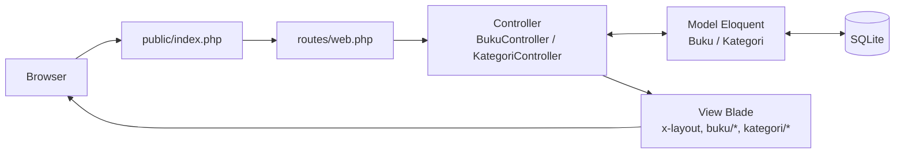
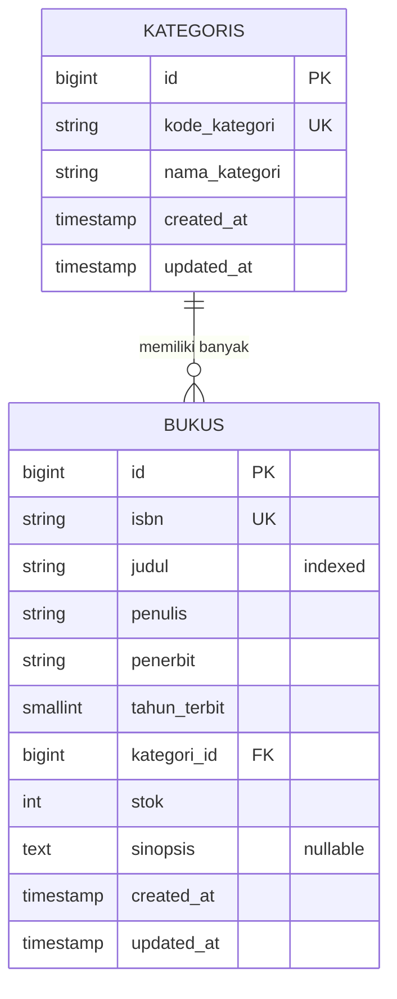

# SIPUS-Del — Sistem Informasi Perpustakaan Kampus Del

Tugas Mandiri Minggu 5, mata kuliah **Pemrograman dan Pengujian Aplikasi Web (12S3101)**,
Institut Teknologi Del.

| | |
|---|---|
| **Pengembang** | Geralda Natali Gultom |
| **NIM** | 12S24051 |
| **Program Studi** | S1 Sistem Informasi |
| **Dosen Pengampu** | Chandro Pardede, S.Kom., M.Sc. |

## Deskripsi

SIPUS-Del adalah aplikasi web pengelolaan koleksi perpustakaan kampus yang dibangun dengan pola
arsitektur **Model-View-Controller (MVC)** menggunakan Laravel. Aplikasi mengelola dua entitas
yang saling berelasi, yaitu **Kategori** dan **Buku** (satu kategori memiliki banyak buku), lengkap
dengan operasi CRUD, validasi sisi server, pagination, dan pesan umpan balik.

## Teknologi

- Laravel 13.x (PHP 8.3 atau lebih baru; dikembangkan pada PHP 8.5.11)
- SQLite sebagai basis data (satu berkas, tanpa instalasi tambahan)
- Blade Component Engine (`<x-layout>`) dan Bootstrap 5.3.3 (CDN)
- Eloquent ORM, Migration, Factory, Seeder, dan Faker (locale `id_ID`)
- Git dan Conventional Commits

## Fitur

- CRUD lengkap untuk **Buku** dan **Kategori** (7 aksi RESTful per entitas)
- Validasi server-side yang ketat dengan pesan berbahasa Indonesia
- Pagination bergaya Bootstrap, flash message, dan tampilan kosong yang informatif
- Pencegahan penghapusan kategori yang masih memiliki buku
- Eager Loading (`with()` dan `withCount()`) untuk mencegah N+1 query
- Tema warna Del Royal Purple (`#4C1D95`), responsif di layar ponsel hingga desktop

## Arsitektur MVC



| Lapisan | Tanggung jawab | Lokasi |
|---|---|---|
| **Model** | Aturan data, relasi, dan akses basis data | `app/Models/Buku.php`, `Kategori.php` |
| **View** | Tampilan HTML (Blade), tanpa logika bisnis | `resources/views/` |
| **Controller** | Menerima request, validasi, memanggil Model, memilih View | `app/Http/Controllers/` |
| **Route** | Memetakan URL ke Controller | `routes/web.php` |

Controller sengaja dibuat tipis: tidak ada HTML dan tidak ada SQL mentah di dalamnya.

## Skema Basis Data



Keputusan perancangan skema:

| Kolom | Pilihan | Alasan |
|---|---|---|
| `isbn` | `string(17)`, `unique` | ISBN-13 berhubung tanda hubung maksimal 17 karakter; tidak boleh ada duplikat |
| `judul` | `string(200)`, `index` | Kolom sering dicari, index mempercepat pencarian |
| `tahun_terbit` | `unsignedSmallInteger` | Tahun hanya butuh bilangan kecil positif |
| `kategori_id` | `foreignId()->constrained()->restrictOnDelete()` | Kategori yang masih punya buku tidak boleh dihapus sehingga data tidak hilang diam-diam |
| `stok` | `unsignedInteger`, default `0` | Stok tidak boleh negatif |
| `sinopsis` | `text`, `nullable` | Teks panjang yang opsional |

Relasi Eloquent: `Kategori::bukus()` bertipe `hasMany` dan `Buku::kategori()` bertipe `belongsTo`.
Kedua model memakai `$fillable` untuk melindungi dari mass assignment.


## Routing RESTful

Didaftarkan dengan `Route::resource()` dan memakai Implicit Route Model Binding.

| Metode | URI | Nama rute | Aksi |
|---|---|---|---|
| GET | `/buku` | `buku.index` | Daftar buku |
| GET | `/buku/create` | `buku.create` | Form tambah |
| POST | `/buku` | `buku.store` | Simpan buku baru |
| GET | `/buku/{buku}` | `buku.show` | Detail buku |
| GET | `/buku/{buku}/edit` | `buku.edit` | Form ubah |
| PUT/PATCH | `/buku/{buku}` | `buku.update` | Simpan perubahan |
| DELETE | `/buku/{buku}` | `buku.destroy` | Hapus buku |
| GET | `/kategori` | `kategori.index` | Daftar kategori |
| GET | `/kategori/create` | `kategori.create` | Form tambah |
| POST | `/kategori` | `kategori.store` | Simpan kategori baru |
| GET | `/kategori/{kategori}` | `kategori.show` | Detail kategori dan bukunya |
| GET | `/kategori/{kategori}/edit` | `kategori.edit` | Form ubah |
| PUT/PATCH | `/kategori/{kategori}` | `kategori.update` | Simpan perubahan |
| DELETE | `/kategori/{kategori}` | `kategori.destroy` | Hapus kategori |

Rute `/` dialihkan ke `buku.index`.


## Validasi Input (Server-Side)

Seluruh validasi dijalankan dengan `$request->validate()` di Controller. Atribut `novalidate`
pada form sengaja dipakai agar validasi server terlihat bekerja.

**Buku**

| Field | Aturan |
|---|---|
| `isbn` | wajib, format 10-17 karakter (angka, X, tanda hubung), **unik** (mengabaikan baris sendiri saat ubah) |
| `judul` | wajib, **minimal 5** dan maksimal 200 karakter |
| `penulis` | wajib, maksimal 150 karakter |
| `penerbit` | wajib, maksimal 100 karakter |
| `tahun_terbit` | wajib, bilangan bulat 1900 sampai tahun berjalan |
| `kategori_id` | wajib, harus ada di tabel `kategoris` |
| `stok` | wajib, bilangan bulat, **minimal 0** |
| `sinopsis` | opsional |

**Kategori:** `kode_kategori` wajib, maksimal 10 karakter, unik; `nama_kategori` wajib, 3-100 karakter.


## Keamanan

| Ancaman | Perlindungan |
|---|---|
| CSRF | Direktif `@csrf` pada semua form; request tanpa token ditolak dengan HTTP 419 |
| XSS | Seluruh output memakai `{{ }}` yang otomatis meng-escape HTML |
| SQL Injection | Hanya memakai Eloquent / Query Builder (prepared statement), tanpa kueri mentah |
| Mass assignment | `$fillable` pada model dan hanya data hasil `validate()` yang disimpan |
| Method spoofing | `@method('PUT')` dan `@method('DELETE')` pada form |
| Integritas data | Foreign key `restrictOnDelete()` dan pengecekan di Controller sebelum menghapus kategori |
| Kredensial | `.env` dan `vendor/` tidak ikut repositori; disediakan `.env.example` |


## Optimasi Kueri: Bukti Eager Loading

Audit kueri dilakukan dengan `DB::listen()` di `AppServiceProvider` (aktif hanya saat `APP_DEBUG=true`)
yang mencatat setiap kueri ke `storage/logs/laravel.log`. Pengukuran pada halaman `/buku` (halaman 1,
10 buku per halaman):

| | Tanpa `with()` | Dengan `with('kategori')` |
|---|---|---|
| Kueri ke tabel `kategoris` | 10 | **1** |
| Total kueri data (count + bukus + kategoris) | 12 | **3** |

Tanpa Eager Loading, setiap baris memicu satu kueri tambahan untuk mengambil kategorinya (**N+1 problem**).
Dengan `Buku::with('kategori')`, kategori seluruh buku diambil dalam satu kueri `WHERE id IN (...)`.
Halaman `/kategori` memakai `withCount('bukus')` sehingga jumlah buku per kategori dihitung dalam satu kueri.

Berkas log mentah: [`docs/audit-sql-sebelum.txt`](docs/audit-sql-sebelum.txt),
[`docs/audit-sql-sesudah.txt`](docs/audit-sql-sesudah.txt), dan
[`docs/audit-sql-kategori.txt`](docs/audit-sql-kategori.txt).


## Mock Data (Factory dan Seeder)

`php artisan migrate:fresh --seed` menghasilkan **7 kategori** (Pemrograman, Basis Data,
Jaringan Komputer, Kecerdasan Buatan, Sistem Informasi, Keamanan Informasi, Manajemen Proyek)
dan **24 buku** yang dibuat `BukuFactory` dengan Faker (locale `id_ID`). Judul dan sinopsis
mengikuti kategori buku sehingga data tampak realistis.


## Cara Menjalankan

Prasyarat: PHP 8.3 atau lebih baru (ekstensi `pdo_sqlite`, `mbstring`, `openssl`, `curl`,
`fileinfo`, `xml`) dan Composer 2.x. Node.js tidak diperlukan karena Bootstrap dimuat lewat CDN.

```bash
git clone https://github.com/GeraldaGultom/ppw-2026-week5-12S24051.git
cd ppw-2026-week5-12S24051
composer install
copy .env.example .env             # Linux/macOS: cp .env.example .env
php artisan key:generate
type nul > database\database.sqlite   # Linux/macOS: touch database/database.sqlite
php artisan migrate --seed
php artisan serve
```

Buka `http://127.0.0.1:8000`.

## Tampilan


## Riwayat Commit

Mengikuti konvensi Conventional Commits. Lima commit utama sesuai modul:
`feat(migration)`, `feat(model)`, `feat(controller)`, `feat(views)`, dan `perf(eager-loading)`.

```
(TEMPEL OUTPUT `git log --oneline` DI SINI)
```

## Catatan Versi

Modul menyebut Laravel 11.x. Proyek ini memakai **Laravel 13.x** karena seluruh rilis Laravel 11
ditolak Composer akibat advisory keamanan yang terdaftar (Laravel 11 sudah tidak menerima perbaikan
keamanan), sedangkan Laravel 13 mendukung PHP 8.3 sampai 8.5. Fitur yang dinilai (MVC, Eloquent,
Route::resource, validasi, Blade Component) tidak berbeda.