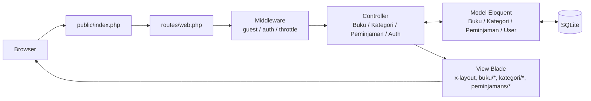
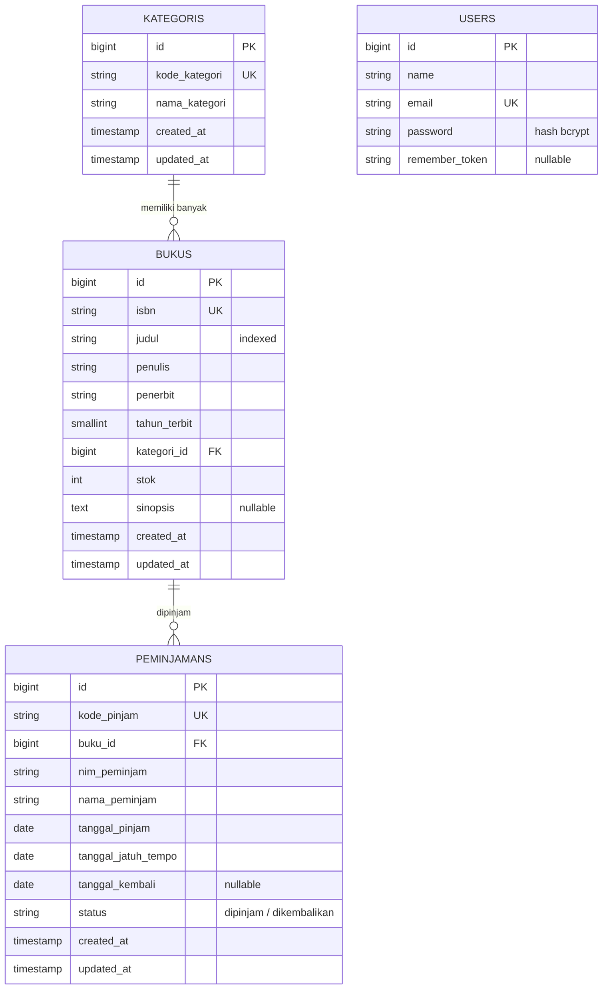

# SIPUS-Del — Sistem Informasi Perpustakaan Kampus Del

Tugas Mandiri Minggu 5 dan 6, mata kuliah **Pemrograman dan Pengujian Aplikasi Web (12S3101)**,
Institut Teknologi Del.

| | |
|---|---|
| **Pengembang** | Geralda Natali Gultom |
| **NIM** | 12S24051 |
| **Program Studi** | S1 Sistem Informasi |
| **Dosen Pengampu** | Chandro Pardede, S.Kom., M.Sc. |
| **Branch Minggu 6** | `week6-db-session` |

## Akun Uji Pustakawan

| Email | Password |
|---|---|
| `pustakawan@del.ac.id` | `password123` |

Akun dibuat otomatis oleh `UserSeeder`. Hanya pustakawan yang sudah login yang dapat mengubah data.
Pengunjung umum hanya dapat melihat daftar dan detail buku serta kategori.

## Deskripsi

SIPUS-Del adalah aplikasi web pengelolaan koleksi perpustakaan kampus yang dibangun dengan pola
arsitektur **Model-View-Controller (MVC)** menggunakan Laravel.

- **Minggu 5:** CRUD **Kategori** dan **Buku** (satu kategori memiliki banyak buku), validasi sisi
  server, pagination, dan Eager Loading.
- **Minggu 6:** sirkulasi peminjaman dan pengembalian buku dengan **transaksi ACID**, statistik
  perpustakaan dengan **Fluent Query Builder**, serta **autentikasi pustakawan** berbasis session dan cookie.

## Teknologi

- Laravel 13.x (PHP 8.3 atau lebih baru; dikembangkan pada PHP 8.5.11)
- SQLite sebagai basis data (satu berkas, tanpa instalasi tambahan)
- Blade Component Engine (`<x-layout>`) dan Bootstrap 5.3.3 (CDN)
- Eloquent ORM, Fluent Query Builder, Migration, Factory, Seeder, dan Faker (locale `id_ID`)
- Session berbasis database (tabel `sessions`) dan `Auth` bawaan Laravel
- PHPUnit (Feature Test)
- Git dan Conventional Commits

## Fitur

- CRUD lengkap untuk **Buku** dan **Kategori** (7 aksi RESTful per entitas)
- Validasi server-side yang ketat dengan pesan berbahasa Indonesia
- Pagination bergaya Bootstrap, flash message, dan tampilan kosong yang informatif
- Pencegahan penghapusan kategori yang masih memiliki buku
- Eager Loading (`with()` dan `withCount()`) untuk mencegah N+1 query
- **Sirkulasi buku:** peminjaman dan pengembalian dalam transaksi ACID dengan `lockForUpdate()`
- **Statistik perpustakaan** via `DB::table()` dan pencarian dinamis `when()` dengan paginasi `withQueryString()`
- **Login/logout pustakawan** dengan regenerasi sesi, cookie, dan proteksi rute `auth`
- Tema warna Del Royal Purple (`#4C1D95`), responsif di layar ponsel hingga desktop

## Arsitektur MVC



| Lapisan | Tanggung jawab | Lokasi |
|---|---|---|
| **Model** | Aturan data, relasi, dan akses basis data | `app/Models/` |
| **View** | Tampilan HTML (Blade), tanpa logika bisnis | `resources/views/` |
| **Controller** | Menerima request, validasi, memanggil Model, memilih View | `app/Http/Controllers/` |
| **Route** | Memetakan URL ke Controller dan memasang middleware | `routes/web.php` |

## Skema Basis Data



Keputusan perancangan skema:

| Kolom | Pilihan | Alasan |
|---|---|---|
| `isbn` | `string(17)`, `unique` | ISBN-13 berhubung tanda hubung maksimal 17 karakter; tidak boleh ada duplikat |
| `judul` | `string(200)`, `index` | Kolom sering dicari, index mempercepat pencarian |
| `tahun_terbit` | `unsignedSmallInteger` | Tahun hanya butuh bilangan kecil positif |
| `bukus.kategori_id` | `foreignId()->constrained()->restrictOnDelete()` | Kategori yang masih punya buku tidak boleh dihapus sehingga data tidak hilang diam-diam |
| `stok` | `unsignedInteger`, default `0` | Stok tidak boleh negatif |
| `sinopsis` | `text`, `nullable` | Teks panjang yang opsional |
| `peminjamans.kode_pinjam` | `string(20)`, `unique` | Setiap transaksi punya kode tunggal yang tidak boleh kembar |
| `peminjamans.buku_id` | `foreignId()->constrained('bukus')->cascadeOnDelete()` | Jika buku dihapus, riwayat peminjamannya ikut terhapus sehingga tidak ada data yatim |
| `peminjamans.tanggal_kembali` | `date`, `nullable` | Baru terisi saat buku dikembalikan |
| `peminjamans` index | `(nim_peminjam, buku_id, status)` | Mempercepat pengecekan "NIM ini masih meminjam buku ini?" |

Relasi Eloquent: `Kategori::bukus()` bertipe `hasMany`, `Buku::kategori()` bertipe `belongsTo`,
`Buku::peminjamans()` bertipe `hasMany`, dan `Peminjaman::buku()` bertipe `belongsTo`.
Semua model memakai `$fillable` untuk melindungi dari mass assignment.
Nama tabel `peminjamans` ditulis eksplisit (`protected $table`) karena pluralisasi otomatis Laravel
akan menghasilkan `peminjamen`.


## Routing RESTful dan Hak Akses

Didaftarkan dengan `Route::resource()` dan memakai Implicit Route Model Binding. Rute yang mengubah
data berada di dalam grup middleware `auth`.

| Metode | URI | Nama rute | Aksi | Akses |
|---|---|---|---|---|
| GET | `/buku` | `buku.index` | Daftar buku, statistik, dan filter | Publik |
| GET | `/buku/{buku}` | `buku.show` | Detail buku | Publik |
| GET | `/buku/create` | `buku.create` | Form tambah | **Login** |
| POST | `/buku` | `buku.store` | Simpan buku baru | **Login** |
| GET | `/buku/{buku}/edit` | `buku.edit` | Form ubah | **Login** |
| PUT/PATCH | `/buku/{buku}` | `buku.update` | Simpan perubahan | **Login** |
| DELETE | `/buku/{buku}` | `buku.destroy` | Hapus buku | **Login** |
| GET | `/kategori` | `kategori.index` | Daftar kategori | Publik |
| GET | `/kategori/{kategori}` | `kategori.show` | Detail kategori dan bukunya | Publik |
| GET/POST/PUT/DELETE | `/kategori/create`, `/kategori`, `/kategori/{kategori}/edit`, `/kategori/{kategori}` | `kategori.create/store/edit/update/destroy` | Ubah data kategori | **Login** |
| GET | `/peminjamans` | `peminjamans.index` | Halaman sirkulasi dan riwayat | **Login** |
| POST | `/peminjamans` | `peminjamans.pinjam` | Proses peminjaman | **Login** |
| POST | `/peminjamans/{id}/kembali` | `peminjamans.kembali` | Proses pengembalian | **Login** |
| GET | `/login` | `login` | Form login | Tamu |
| POST | `/login` | `login.attempt` | Proses login (`throttle:5,1`) | Tamu |
| POST | `/logout` | `logout` | Keluar dan hapus sesi | **Login** |

Rute `/` dialihkan ke `buku.index`. Rute `show` didaftarkan setelah `create` agar `/buku/create`
tidak dianggap sebagai ID buku.


## Validasi Input (Server-Side)

Seluruh validasi dijalankan dengan `$request->validate()` di Controller. Atribut `novalidate`
pada form sengaja dipakai agar validasi server terlihat bekerja.

**Buku**

| Field | Aturan |
|---|---|
| `isbn` | wajib, format 10-17 karakter (angka, X, tanda hubung), **unik** (mengabaikan baris sendiri saat ubah) |
| `judul` | wajib, **minimal 5** dan maksimal 200 karakter |
| `penulis` | wajib, maksimal 150 karakter |
| `penerbit` | wajib, maksimal 100 karakter |
| `tahun_terbit` | wajib, bilangan bulat 1900 sampai tahun berjalan |
| `kategori_id` | wajib, harus ada di tabel `kategoris` |
| `stok` | wajib, bilangan bulat, **minimal 0** |
| `sinopsis` | opsional |

**Kategori:** `kode_kategori` wajib, maksimal 10 karakter, unik; `nama_kategori` wajib, 3-100 karakter.

**Peminjaman:** `buku_id` wajib dan harus ada di tabel `bukus`; `nim_peminjam` wajib, 6-15 karakter;
`nama_peminjam` wajib, 3-150 karakter. **Login:** `email` wajib dan berformat email; `password` wajib.


## Transaksi ACID dan Concurrency Locking

Peminjaman dan pengembalian mengubah lebih dari satu tabel (`bukus` dan `peminjamans`), sehingga
keduanya dibungkus `DB::transaction()` (dengan 3 kali percobaan ulang jika terjadi deadlock).

**Alur peminjaman** (`PeminjamanController@pinjam`):

1. Kunci baris buku dengan `Buku::where('id', $id)->lockForUpdate()->firstOrFail()`.
2. Periksa `stok >= 1` **setelah** kunci diambil; jika stok 0, lempar `RuntimeException` sehingga transaksi di-rollback.
3. Tolak jika NIM yang sama masih meminjam buku yang sama dan belum mengembalikannya.
4. Kurangi stok dengan `decrement('stok')` dan catat ke tabel `peminjamans`.

**Alur pengembalian** (`PeminjamanController@kembali`): kunci baris peminjaman dan baris buku,
tolak jika sudah dikembalikan, lalu `increment('stok')`, ubah status menjadi `dikembalikan`, dan isi `tanggal_kembali`.

| Prinsip | Implementasi |
|---|---|
| **Atomicity** | Pengurangan stok dan pencatatan peminjaman berhasil bersama atau batal bersama |
| **Consistency** | Stok tidak pernah minus; satu NIM tidak bisa meminjam buku yang sama dua kali sebelum mengembalikan |
| **Isolation** | `lockForUpdate()` (`SELECT ... FOR UPDATE`) membuat dua request untuk eksemplar terakhir mengantre, sehingga tidak bisa sama-sama lolos cek stok |
| **Durability** | Setelah `COMMIT`, data tersimpan permanen di basis data |

`QueryException` ditangkap dan dicatat lewat `Log::error()` ke `storage/logs/laravel.log`; pengguna hanya
melihat pesan umum agar struktur basis data tidak bocor.

> **Catatan mesin basis data.** Proyek ini memakai SQLite. SQLite mengunci seluruh basis data saat
> menulis dan mengabaikan klausa `FOR UPDATE`, sehingga transaksi tetap aman tetapi bukan kunci tingkat baris.
> Kunci tingkat baris bekerja penuh pada MySQL/InnoDB. Kode ditulis identik untuk kedua mesin.

### Bukti pengujian

| Skenario | Hasil | Bukti |
|---|---|---|
| Peminjaman normal | Stok berkurang, riwayat tercatat |  |
| Pengembalian | Stok bertambah, status `dikembalikan` |  |
| Pinjam saat stok = 0 | Ditolak, stok tetap 0 |  |
| NIM sama, buku sama | Ditolak |  |
| Kegagalan setelah stok dikurangi | Rollback, stok kembali seperti semula |  |

Pengujian otomatis ada di `tests/Feature/SirkulasiTest.php`. Test rollback memaksa INSERT peminjaman
gagal **setelah** stok dikurangi, lalu memastikan stok kembali ke nilai awal.

```bash
php artisan test
```

## Query Builder, Agregasi, dan Filter Dinamis

Halaman `/buku` menampilkan empat kartu statistik yang dihitung dengan Fluent Query Builder (`DB::table()`),
tanpa membuat objek Model karena hanya angka agregat yang dibutuhkan:

| Statistik | Query |
|---|---|
| Total Judul Buku | `DB::table('bukus')->count()` |
| Total Stok Tersedia | `DB::table('bukus')->sum('stok')` |
| Sedang Dipinjam | `DB::table('peminjamans')->where('status', 'dipinjam')->count()` |
| Total Dikembalikan | `DB::table('peminjamans')->where('status', 'dikembalikan')->count()` |

Katalog memakai `Buku::with('kategori')->withCount('peminjamans')`, pencarian dinamis `when()`
(judul, penulis, ISBN) digabung filter kategori, dan `paginate(10)->withQueryString()` agar filter
tetap aktif saat pindah halaman. Kondisi `orWhere` pencarian dibungkus closure supaya tidak merusak
filter kategori (`kategori = X AND (judul OR penulis OR isbn)`).


## Session, Cookie, dan Autentikasi

| Aspek | Implementasi |
|---|---|
| Penyimpanan sesi | Driver `database`: payload sesi di tabel `sessions` (server), browser hanya memegang Session ID |
| Login | `Auth::attempt()` memverifikasi email dan hash password |
| Session Fixation | `$request->session()->regenerate()` setelah login berhasil |
| Logout | `Auth::logout()`, `session()->invalidate()`, dan `regenerateToken()` |
| State sesi | `login_timestamp`, `last_search`, dan `last_borrower` |
| Cookie | `Cookie::queue('del_last_user_email', ..., 10080)`; terenkripsi dan `HttpOnly` |
| Proteksi rute | Middleware `auth` pada semua rute yang mengubah data; tamu dialihkan ke `/login` |
| Brute force | `throttle:5,1` pada `POST /login` |
| Pesan error login | Umum ("Kredensial login tidak valid"), tidak membedakan email salah atau password salah |

### Audit Cookie di DevTools

| Bukti | Gambar |
|---|---|
| Session ID sebelum login |  |
| Session ID berbeda setelah login (`regenerate()`) |  |
| Flag `HttpOnly` dan `SameSite=Lax` |  |
| `document.cookie` tidak memuat `laravel_session` |  |
| Data sesi di tabel `sessions` |  |
| Setelah logout |  |

Flag `Secure` kosong pada `http://localhost`. Di produksi (HTTPS) diaktifkan dengan `SESSION_SECURE_COOKIE=true`.

## Keamanan

| Ancaman | Perlindungan |
|---|---|
| CSRF | Direktif `@csrf` pada semua form; request tanpa token ditolak dengan HTTP 419 |
| XSS | Seluruh output memakai `{{ }}` yang otomatis meng-escape HTML; cookie sesi `HttpOnly` |
| SQL Injection | Hanya memakai Eloquent / Query Builder (prepared statement dan parameter binding), tanpa kueri mentah |
| Mass assignment | `$fillable` pada model dan hanya data hasil `validate()` yang disimpan |
| Method spoofing | `@method('PUT')` dan `@method('DELETE')` pada form |
| Session Fixation | Regenerasi Session ID saat login; invalidasi sesi saat logout |
| Brute force login | `throttle:5,1` |
| Akses tanpa izin | Middleware `auth` pada rute mutasi; tombol ubah dan hapus disembunyikan dengan `@auth` |
| Race condition stok | `DB::transaction()` dan `lockForUpdate()` |
| Integritas data | Foreign key `restrictOnDelete()` pada kategori dan pengecekan sebelum menghapus kategori |
| Kebocoran detail galat | `QueryException` hanya dicatat ke log; pengguna melihat pesan umum |
| Kredensial | `.env` dan `vendor/` tidak ikut repositori; disediakan `.env.example` |


## Optimasi Kueri: Bukti Eager Loading

Audit kueri dilakukan dengan `DB::listen()` di `AppServiceProvider` (aktif hanya saat `APP_DEBUG=true`)
yang mencatat setiap kueri ke `storage/logs/laravel.log`. Pengukuran pada halaman `/buku` (halaman 1,
10 buku per halaman, versi Minggu 5):

| | Tanpa `with()` | Dengan `with('kategori')` |
|---|---|---|
| Kueri ke tabel `kategoris` | 10 | **1** |
| Total kueri data (count + bukus + kategoris) | 12 | **3** |

Tanpa Eager Loading, setiap baris memicu satu kueri tambahan untuk mengambil kategorinya (**N+1 problem**).
Dengan `Buku::with('kategori')`, kategori seluruh buku diambil dalam satu kueri `WHERE id IN (...)`.
Pada Minggu 6, `withCount('peminjamans')` menghitung jumlah peminjaman lewat satu subquery, sehingga
jumlah kueri tetap konstan berapa pun jumlah buku.

Halaman `/kategori` memakai `withCount('bukus')` sehingga jumlah buku per kategori dihitung dalam satu kueri.

Berkas log mentah: [`docs/audit-sql-sebelum.txt`](docs/audit-sql-sebelum.txt),
[`docs/audit-sql-sesudah.txt`](docs/audit-sql-sesudah.txt), dan
[`docs/audit-sql-kategori.txt`](docs/audit-sql-kategori.txt).

Bukti `withCount` Minggu 6 (dari `php artisan tinker`, `DB::getQueryLog()`):


## Mock Data (Factory dan Seeder)

`php artisan migrate:fresh --seed` menghasilkan:

- **7 kategori** (Pemrograman, Basis Data, Jaringan Komputer, Kecerdasan Buatan, Sistem Informasi,
  Keamanan Informasi, Manajemen Proyek) dan **24 buku** dari `BukuFactory` dengan Faker (locale `id_ID`).
- **Akun pustakawan uji** (`pustakawan@del.ac.id` / `password123`) dari `UserSeeder`.
- **Data uji sirkulasi** dari `BukuUjiSeeder`: buku `Uji Stok Nol` (stok 0), `Uji Stok Satu` (stok 1),
  dan `Uji Sirkulasi` (stok 4) beserta dua sampel peminjaman (satu masih dipinjam, satu sudah dikembalikan).
  Stok dibuat konsisten dengan data peminjaman agar statistik tidak janggal.

Seeder memakai `updateOrCreate` dengan kunci unik sehingga aman dijalankan berulang.


## Cara Menjalankan

Prasyarat: PHP 8.3 atau lebih baru (ekstensi `pdo_sqlite`, `mbstring`, `openssl`, `curl`,
`fileinfo`, `xml`) dan Composer 2.x. Node.js tidak diperlukan karena Bootstrap dimuat lewat CDN.

```bash
git clone https://github.com/GeraldaGultom/ppw-2026-week5-12S24051.git
cd ppw-2026-week5-12S24051
git checkout week6-db-session
composer install
copy .env.example .env             # Linux/macOS: cp .env.example .env
php artisan key:generate
type nul > database\database.sqlite   # Linux/macOS: touch database/database.sqlite
php artisan migrate --seed
php artisan serve
```

Pengaturan penting di `.env`: `DB_CONNECTION=sqlite`, `SESSION_DRIVER=database`, `APP_TIMEZONE=Asia/Jakarta`.

Buka `http://127.0.0.1:8000`, lalu masuk lewat `/login` dengan akun uji di atas.

## Tampilan


## Riwayat Commit

Mengikuti konvensi Conventional Commits. Minggu 5: `feat(migration)`, `feat(model)`, `feat(controller)`,
`feat(views)`, dan `perf(eager-loading)`. Minggu 6: `feat(migration)`, `feat(model)`, `feat(auth-session)`,
`feat(transaction)`, `feat(query-builder)`, `feat(seeder)`, `test(circulation)`, dan `docs(readme)`.

```
(TEMPEL OUTPUT `git log --oneline` DI SINI)
```

## Catatan Versi

Modul menyebut Laravel 11.x. Proyek ini memakai **Laravel 13.x** karena seluruh rilis Laravel 11
ditolak Composer akibat advisory keamanan yang terdaftar (Laravel 11 sudah tidak menerima perbaikan
keamanan), sedangkan Laravel 13 mendukung PHP 8.3 sampai 8.5. Fitur yang dinilai (MVC, Eloquent,
Route::resource, validasi, Blade Component, transaksi, session, dan autentikasi) tidak berbeda.